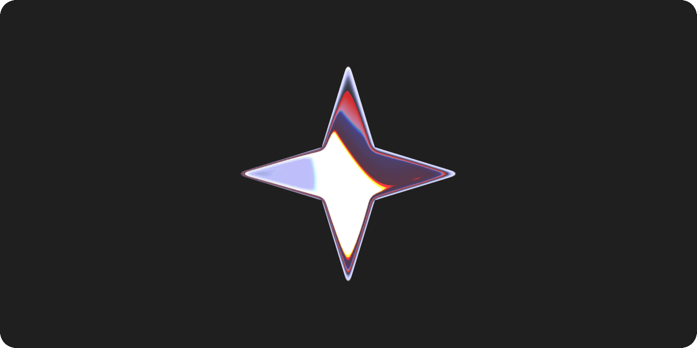
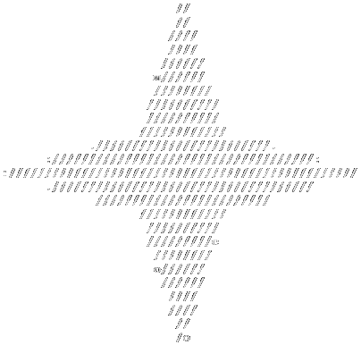

  

<h1 align="center">DOME — SOMEBODYWANT3D</h1>

  Portfolio of <strong>Domenico Fusto</strong> — art direction, interaction design and UI 
  <a href="https://www.somebodywant3d.com">www.somebodywant3d.com</a>

---

## What it is

DOME is the one-page portfolio of **Domenico Fusto**, a designer working between
art direction, interaction design and front-end. It is published at
[www.somebodywant3d.com](https://www.somebodywant3d.com) and it is meant to be
experienced, not read: one scroll, one visual language, and almost every element
answers to the pointer.

The site has three faces of the same idea. There is the **work** — a hero built
on a live water-and-rain shader, an archive of ten projects that each keep
their own preview alive, and three case studies for generative systems. There is
the **motion**: images that dissolve into their colour version under the cursor,
type that warps as you cross it, a ring of names turning around the mark. And
there is the **sound**: a bed that loops seamlessly, clicks on every interaction
and, in the hero, the flow of water that answers to how fast you move.

Nothing is decorative-only. Every effect is the explanation of something.

---

## The experience, section by section

### Hero

The DOME mark sits over a live water-and-rain shader, with a ring of names
turning around it. The whole field reacts to the pointer: the water follows the
cursor, and the faster you move, the louder and brighter the flow becomes.

### Entry

The introduction, typed over glass, where the type reacts to being crossed —
each word bends and blurs as the cursor passes through it.

### Featured gallery

Six covers, each of them a project in its own right. Passing the cursor over a
cover dissolves it into its colour version; on touch, the effect follows the
floating cursor you drag with your finger.

| Project | What it is |
| --- | --- |
| **AlFly** | Transport app for saving tickets |
| **SISALFUNCLUB** | New game experience |
| **iTour** | Travel app for connecting with strangers |
| **uBank** | Home banking for busy people |
| **Policlinico di Milano** | New experience for blood donations |
| **Twitch** | App redesign for a new experience |

### Selected projects

Three case studies on generative systems, each one built as a small instrument
rather than a page.

**PARTICLES** — 2023 · *Immersive Experience, Music React, TouchDesigner*
A generative system that visualises real-time data — here derived from a piece of
music — through the expansion and animation of an object and of its constituent
particles. Music acts as the effector: it drives the parameters, and the system
shows the result on screen.

**ƒ Generator** — 2024 · *Personal Project, Generative System, TouchDesigner, GLSL*
A reactive visualisation that responds dynamically to any kind of input and
generates abstract graphics and forms. A 32 × 32 grid of random patterns is
generated from mathematical functions, and a merge value applied to the squares
creates fluid, viscous "gooey" effects based on their proximity.

**ISTOGram** — 2024 · *Personal Project, Generative System, TouchDesigner, Noise React*
A scene built from a flat element whose vertices throw straight lines, visible
according to their proximity to the camera. The system is fully modal: the shape,
its colouring and its behaviour are parameters, not fixed decisions.

### Archives

Ten older works, each with a preview that stays live while you look at it.

| # | Project | Field | Year |
| --- | --- | --- | --- |
| 01 | AlFly | Urban transportation | 2022 |
| 02 | Policlinico di Milano | Healthcare experience | 2022 |
| 03 | uBank | Home banking | 2024 |
| 04 | SISALFUNCLUB | Game app experience | 2022 |
| 05 | iTour | Travel manager | 2022 |
| 06 | CYP Wheels | Custom e-commerce | 2026 |
| 07 | Dulcis in Fundo | Custom e-commerce | 2025 |
| 08 | Collezione Cagnola | Custom e-commerce | 2025 |
| 09 | Sielco | IT website | 2025 |
| 10 | Marabini Recuperi | Business website | 2026 |

---

## The sound

The site has a voice, and it is under your control: the **Sound** switch in the
header turns everything on or off at once.

- **Clicks** — a small, varied tick on every interaction, never the same twice.
- **Ambient** — a bed that loops with a one-second crossfade: the outgoing second
  fades down while the next one fades up, so the loop point is inaudible.
- **Water** — in the hero, moving the cursor plays the flow. The faster you
  move, the higher its pitch; several strokes overlap, each one louder than the
  ones before it, until they fade into each other.

Browsers only let a page make noise after you have interacted with it, so on a
first visit the site asks for that interaction in its own way: a small chip under
the header says *click anywhere to play sounds*. Nothing is forced — the header
switch silences everything, and the choice is remembered.

---

## The console

Open the developer console and the site says hello: its own animated GIF is
printed once, with two lines of credit under it. Nothing else is logged, and the
console is never cleared.

  

---

## Under the hood

React and Vite, with Three.js and WebGPU for the real-time work, GSAP for the
motion and Lenis for the scroll. The site ships as a static bundle and runs
from GitHub Pages.

---

MIT Licence — Copyright (c) 2026 Domenico Fusto.
